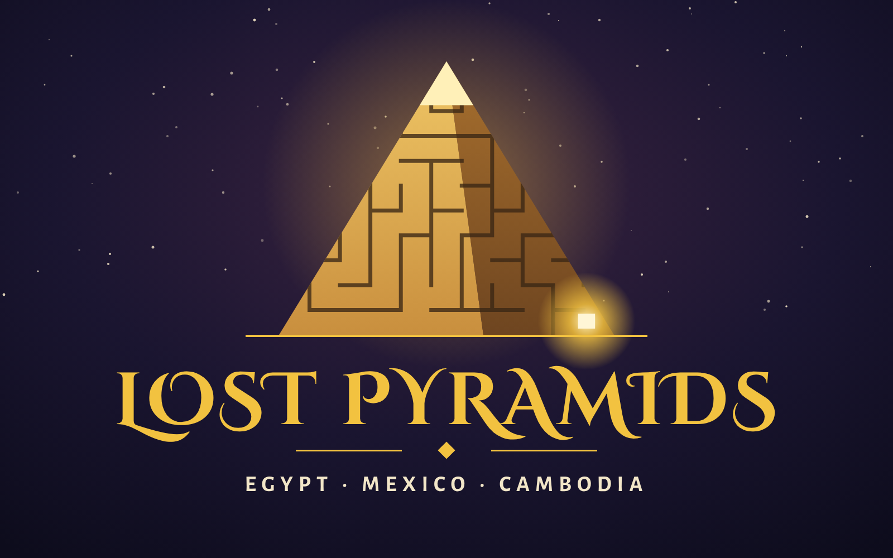
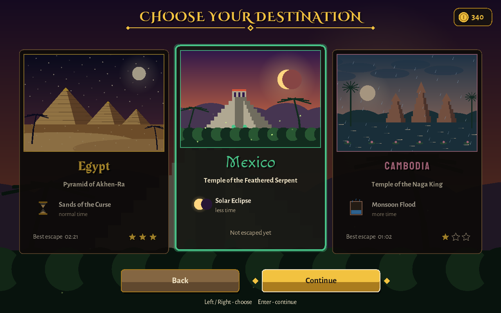
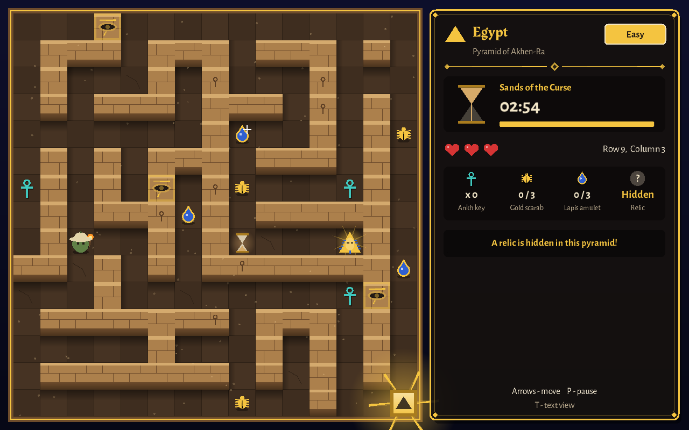
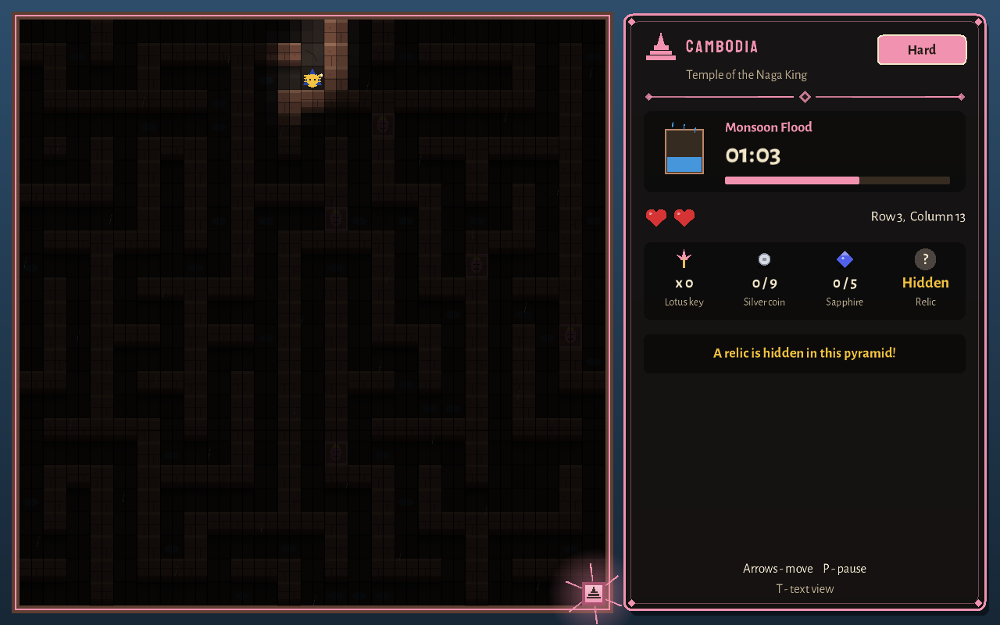

 
 
---
 
## 📜 Table of Contents
 
- [About the Project](#about)
- [Screenshots](#screenshots)
- [Used Technologies](#technologies)
- [Documentation](#documentation)
- [Contributors](#contributors)
 
---
 

## 🏺 About the Project
 
**Lost Pyramids** is a maze game. You are an explorer sent to three ancient pyramids - in **Egypt**, **Mexico** and **Cambodia**. Every expedition builds a brand-new labyrinth. You start in the **top-left corner** and must reach the **exit gate in the bottom-right corner** before the location's timer runs out.
 
We did not want a plain grey labyrinth, so we picked one theme and kept it everywhere. Each location has its own story, colours, font, timer, guardian, keys, traps and treasure - but all three share the same rules and the same code.
 
**Features**
 
- 🧭 **A new pyramid every time** - randomly generated, with rooms, loops and dead ends. The exit can always be reached.
- 🔦 **Three difficulties** - Easy is fully lit, Medium gives you a torch, Hard only a flashlight and a guardian that hunts you.
- 🗝️ **Secret doors** - walls with a carving that open with a key. Every door is a real shortcut.
- 💰 **Rewards** - score, up to 3 stars, coins and rare relics.
- 🛒 **Trading Post** - sell relics and buy six explorer skins.
- 🔤 **Text view** - press **T** to see the classic text version of the maze.
- 👤 **Accounts** - sign up and log in; passwords are saved only as a salted hash.
- 🏆 **Hall of Fame** - the best scores, with filters by location and difficulty.
 
---
 

## 📸 Screenshots
 

 
<i>Choose your destination: Egypt, Mexico or Cambodia</i>

 

 
<i>Egypt - Easy: the whole pyramid is lit</i>

 

 
<i>Cambodia - Hard: only the flashlight lights the way</i>

 
---
 

## 🛠 Used Technologies
 
| Logo | Tool | Purpose |
|:---:|---|---|
|  | [C++17](https://isocpp.org/) | Programming language |
|  | [raylib 6.0](https://www.raylib.com/) | Window, graphics and input |
|  | [CMake](https://cmake.org/) | Building the game and the tests |
|  | [Visual Studio 2022](https://visualstudio.microsoft.com/) | Primary IDE |
|  | [GitHub](https://github.com/) | Version control and project board |
|  | [Microsoft Word](https://www.microsoft.com/microsoft-365/word) | Documentation |
|  | [Microsoft PowerPoint](https://www.microsoft.com/microsoft-365/powerpoint) | Presentation |
|  | [Microsoft Excel](https://www.microsoft.com/microsoft-365/excel) | QA test cases |
|  | [Microsoft Teams](https://www.microsoft.com/microsoft-teams) | Communication |
|  | [Canva](https://www.canva.com/) | Logo design |
 
---
 

## 📚 Documentation
 
| Documentation | File |
|---|---|
| Documentation (Word) | [`Lost_Pyramids_Documentation.docx`](lost-pyramids/docs/Lost_Pyramids_Documentation.docx) |
| Presentation | [`Lost_Pyramids_Presentation.pptx`](lost-pyramids/docs/Lost_Pyramids_Presentation.pptx) |
| QA test cases | [`QA_Test_Cases.xlsx`](lost-pyramids/docs/QA_Test_Cases.xlsx) |
 
---
 

## 👥 Contributors
 
| Name | Role | GitHub | Responsibilities |
|---|---|---|---|
| *Mariela Apostolova* | SCRUM Trainer | *MQApostolova24@codingburgas.bg* | Planning, GitHub board, presentation |
| *Nikoleta Georgieva* | Backend Developer | *NGGeorgieva24@codingburgas.bg* | Game logic and data files |
| *Bozhidar Stanev* | Frontend Developer | *BIStanev24@codingburgas.bg* | Screens, graphics, input |
| *Yanislav Todorov* | Backend Developer | *YNTodorov24@codingburgas.bg* | Test functions, QA workbook |
 
---
